# Explora Castellar

Proyecto de PMDM - 2º DAM
Victor Bustos

App para descubrir lugares de Castellar-l'Oliveral y alrededores y hacer retos en ellos, tipo yincana. De momento tiene la pantalla principal con la lista de lugares, un buscador y un contador de los lugares visitados.

## Estructura

```
app/src/main/java/com/victorbustos/exploracastellar/
├── MainActivity.kt        (actividad y componentes de la pantalla)
├── data/
│   ├── DatosEjemplo.kt    (6 lugares y 13 retos)
│   └── model/             (Lugar, Reto, Dificultad, TipoReto)
└── ui/theme/              (Color.kt, Theme.kt, Type.kt)

res/values/strings.xml     (español)
res/values-en/strings.xml  (inglés)
```

- minSdk 26, targetSdk 36
- Jetpack Compose con Material 3

El modelo tiene `Lugar` y `Reto` como data class, `Dificultad` como enum y `TipoReto` como sealed interface (Pregunta, Foto y Busca).

La pantalla está separada en componentes: `AppExplora` (Scaffold con la barra de arriba), `PantallaPrincipal`, `Buscador`, `BarraContador`, `Tarjetas`, `TarjetaLugar` e `InsigniaVisitado`.

## Decisiones

- **El estado está en `PantallaPrincipal`** y los demás componentes no guardan nada: reciben los datos y avisan con una función cuando cambia algo (`onTextoChange`, `onVisitadoChange`). Para marcar un lugar como visitado uso `copy` sobre la lista.
- **Los textos de los lugares y retos son `@StringRes`** en vez de `String`, para poder traducirlos. Las respuestas de los retos también.
- **`rememberSaveable`** para que no se pierda lo buscado ni las casillas al girar el móvil.
- **El contador usa `plurals`.** Cambié la frase a "1 lugar visitado de 6" porque con "X de 6 lugares visitados" el plural dependía del total y nunca cambiaba.
- **Los colores están en el tema** (`Color.kt` y `Theme.kt`), con una versión para claro y otra para oscuro. Quité el color dinámico para que salgan siempre mis colores.
- **El título usa `autoSize`** para que se haga más pequeño si no cabe (por ejemplo con la fuente grande).
- La insignia la saqué a un componente aparte porque tiene su propia lógica (cambia texto, color y el tick).
- Las fotos están en webp para que pesen menos.

## Idiomas

Español por defecto e inglés en `values-en`. Tengo activado `generateLocaleConfig`, así que se puede cambiar el idioma solo de la app desde los ajustes del móvil. Hay previews en claro, oscuro e inglés.

## Pruebas

He probado la app en dos perfiles de emulador: un **móvil (Pixel 9a)** y una **tablet**. En los dos he probado el modo claro, el modo oscuro, la fuente grande y la rotación.

### Móvil

| Claro | Oscuro |
|---|---|
| 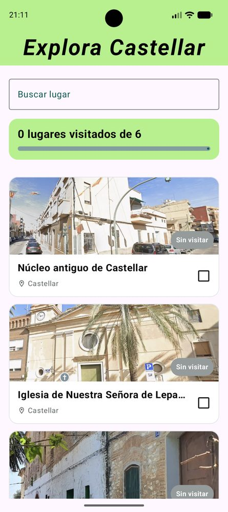 | 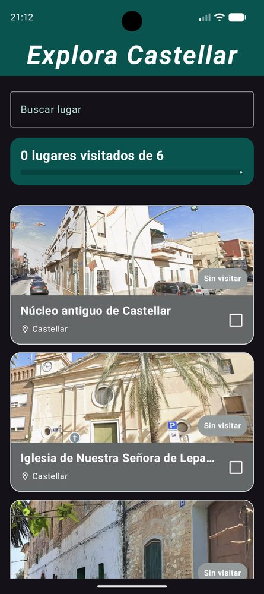 |

**Rotación (horizontal):**

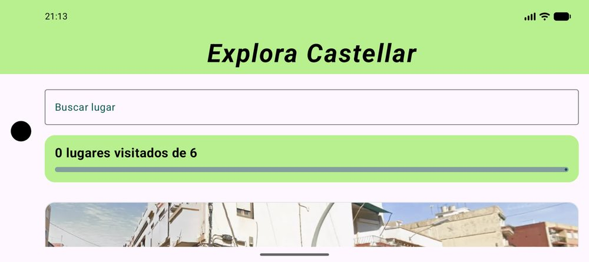

### Tablet

| Claro | Oscuro |
|---|---|
| 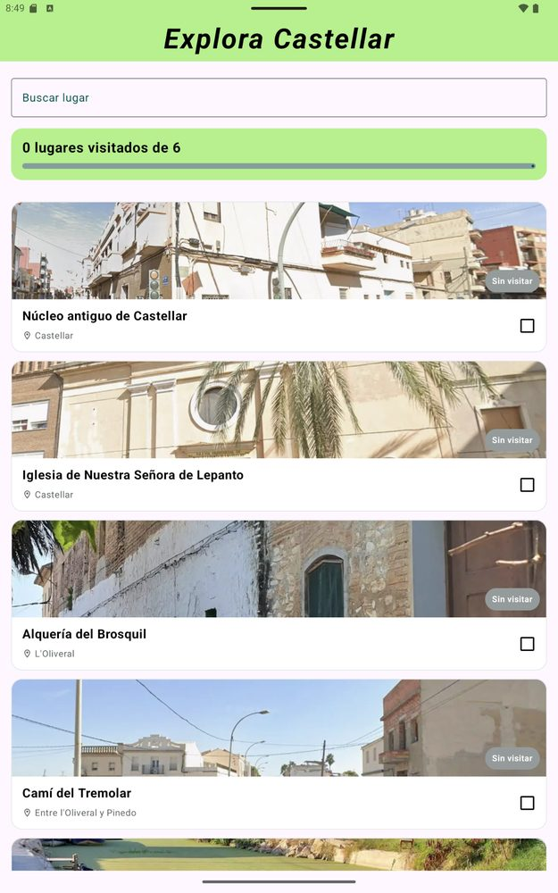 | 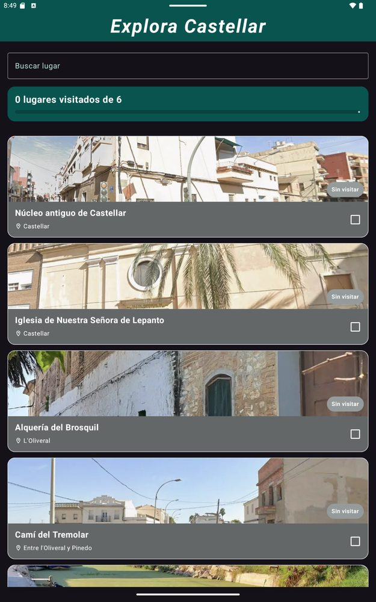 |

| Fuente grande | Horizontal y en inglés |
|---|---|
| 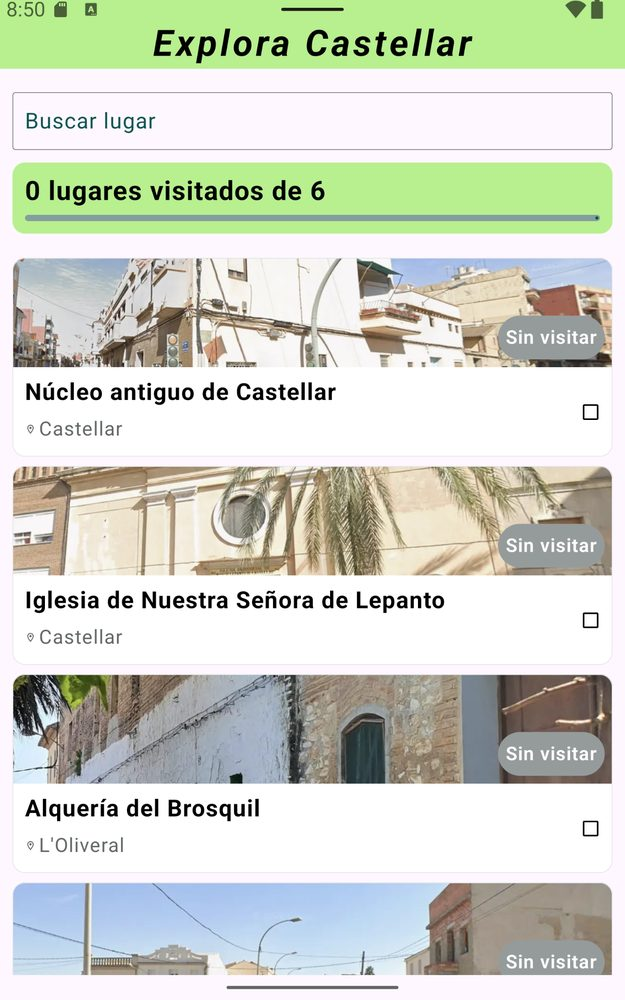 | 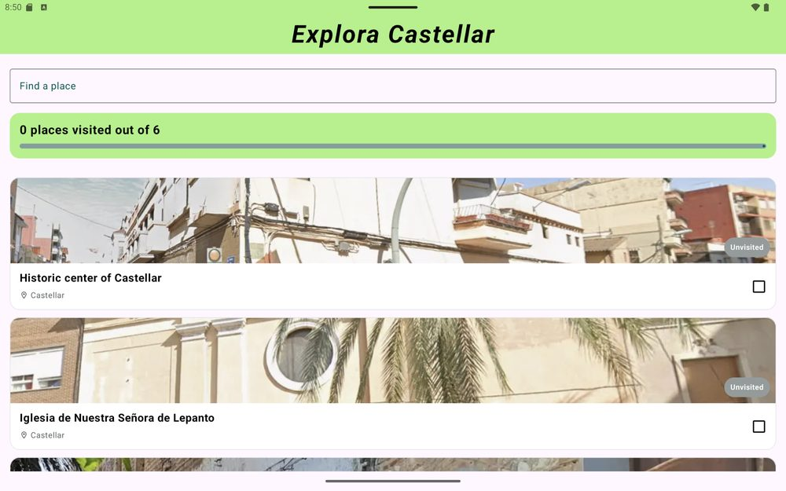 |

### Fuente grande en el móvil (antes y después)

Al poner la fuente al máximo encontré dos fallos:
1. **El título** (40 sp con un padding de 20 dp) no cabía en la barra: se partía en dos líneas que se montaban una encima de la otra.
2. **La insignia** tenía una altura fija de 24 dp y el texto se cortaba por arriba y por abajo.

Lo arreglé así:
- El título ahora usa `autoSize` con `maxLines = 1`, como explico en las decisiones.
- A la insignia le quité la altura fija y le puse `padding(vertical = 4.dp)` para que crezca con el texto. También la moví a la esquina inferior derecha de la foto, porque antes tapaba parte del nombre del lugar.

| Antes | Después |
|---|---|
| 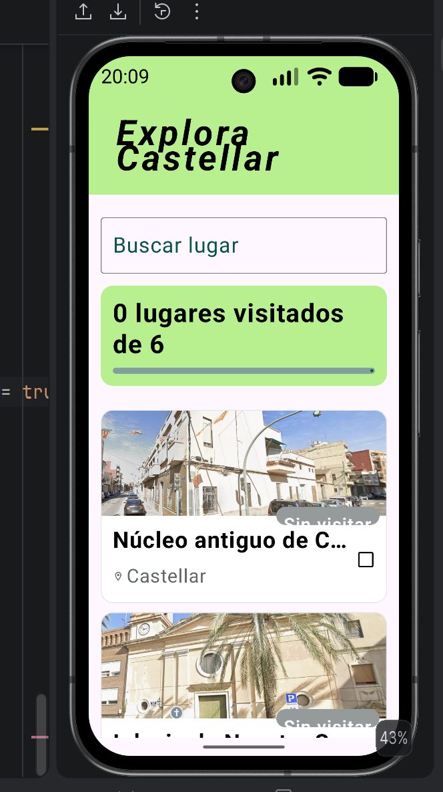 | 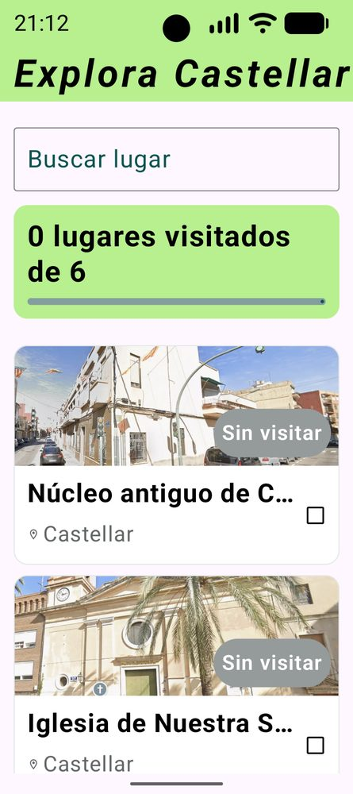 |

## Ciclo de vida

He puesto un `Log.d` con la etiqueta `CicloVida` en `onCreate`, `onStart`, `onResume`, `onPause`, `onStop` y `onDestroy`. Al girar el móvil sale onPause, onStop, onDestroy y luego otra vez onCreate, onStart y onResume, o sea que la actividad se destruye y se vuelve a crear. Por eso hace falta `rememberSaveable`.

<!-- 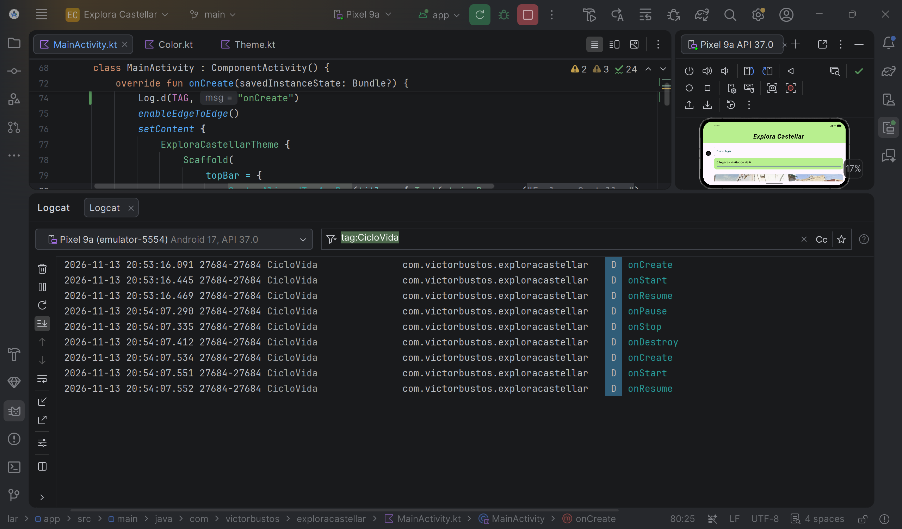 -->

## Depuración

Para practicar con el depurador provoqué un error con la división entera en la barra de progreso:

```kotlin
val progreso = (visitados / total).toFloat()
```

El contador decía "2 lugares visitados de 6" pero la barra no se movía.

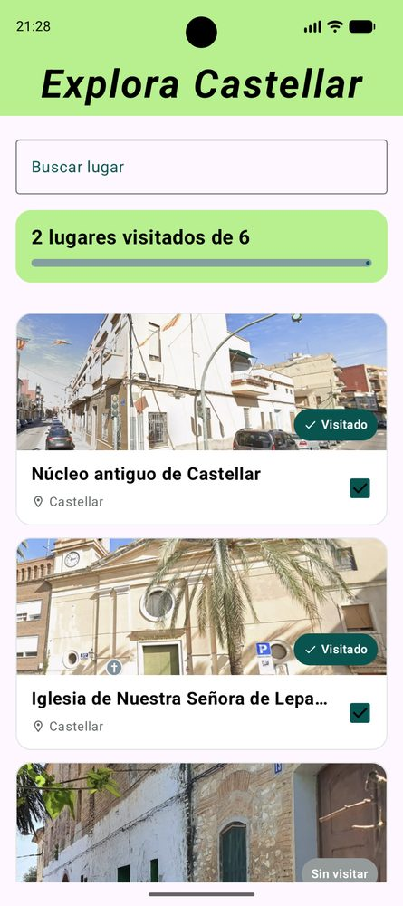

Puse un breakpoint en esa línea y con el depurador vi que `total` era 6 y `visitados` 3, pero `visitados / total` daba 0. Al ser los dos `Int`, la división quita los decimales y el `toFloat()` llega tarde.

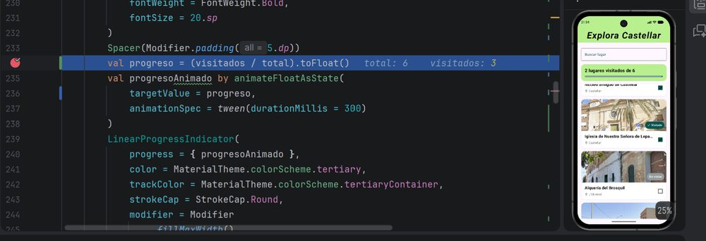

Lo arreglé convirtiendo antes de dividir:

```kotlin
val progreso = if (total == 0) 0f else visitados.toFloat() / total
```

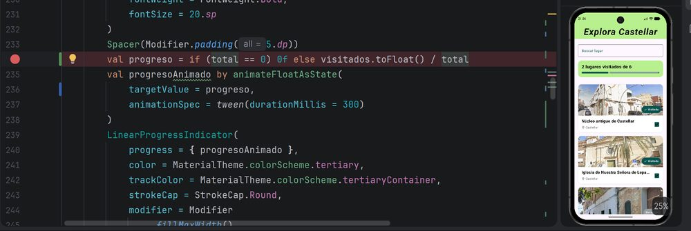

## Problemas que he tenido

- Al hacer las tarjetas `Text(lugar.nombre)` daba error porque es un `Int` (id del recurso). Hay que usar `stringResource`.
- Al separar las tarjetas en otro componente, el `weight` daba error porque solo funciona dentro de una Column o Row. Lo pasé como `modifier` desde fuera.
- Tampoco podía cambiar `lugares` desde dentro del componente porque los parámetros no se pueden modificar, así que el componente avisa y lo cambia `PantallaPrincipal`.
- En modo claro no se veía la zona de las tarjetas porque el texto era blanco sobre blanco. Lo arreglé al ordenar los colores del tema.
- Las previews salían en inglés y tuve que poner `locale = "es"`.
- El emulador no arrancaba porque había desactivado el hipervisor de Windows para VirtualBox.

## Cosas a mejorar

- El buscador no encuentra "alqueria" sin tilde, solo con tilde.
- En la tablet las fotos quedan muy estiradas, estaría mejor una cuadrícula.
- La descripción y los retos aún no se muestran en ningún sitio.
